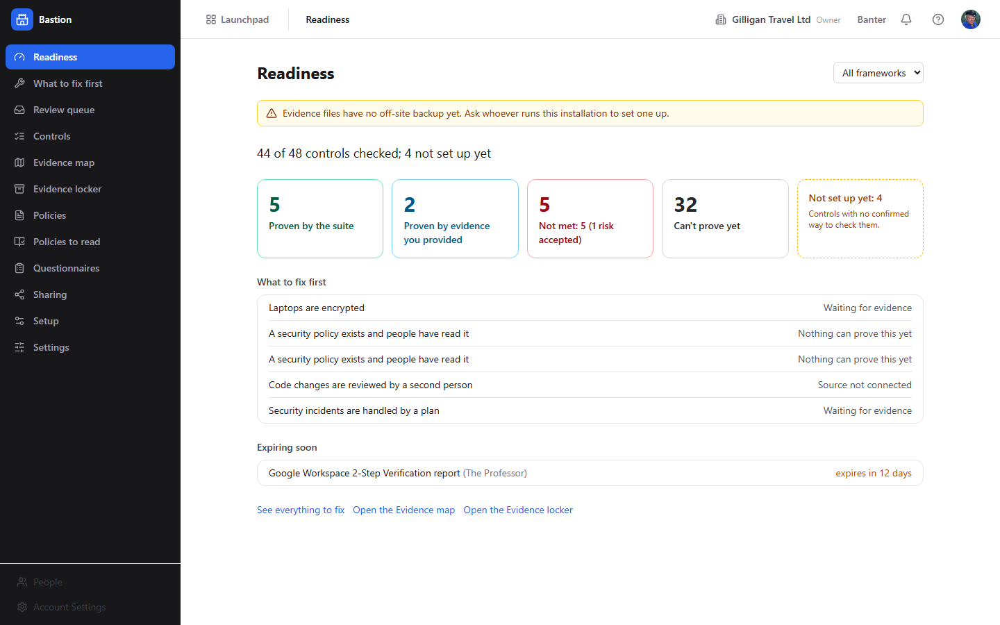
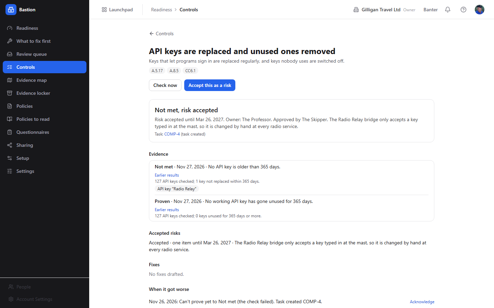
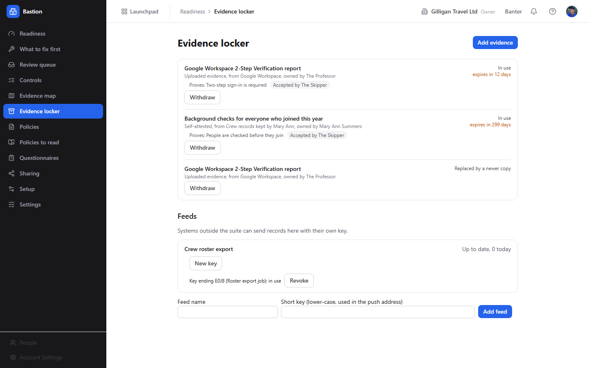
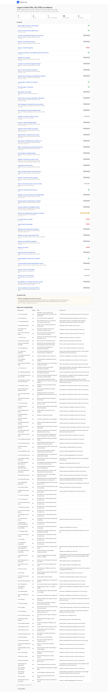

# Bastion (Continuous Compliance Readiness) Guide

# Bastion - Know every night how ready you are for your audit

Bastion is BigBlueBam's compliance readiness tool for SOC 2 and ISO 27001. A small company usually meets compliance at its first big customer: a long security questionnaire arrives, or the buyer asks for a SOC 2 report, and someone has to find out what the company actually does and prove it. Bastion does that work continuously. Every night it checks your controls against what really happened in the suite (who has access, how old the API keys are, whether merged code was reviewed, whether people read the security policy, whether backups ran), keeps a tamper-evident record of each result, and lists first the controls nothing can prove yet, each with a fix already drafted. For the things the suite cannot see, people upload evidence or write a statement, and a second person reviews it. When the audit comes, you share a private, expiring auditor room or hand over an audit packet. This guide explains, in plain language, what Bastion's words mean and why it behaves the way it does.

## Bastion is not an auditor

Bastion helps you prepare. It does not audit you, it does not certify anything, and nothing it shows is an audit opinion or a SOC 2 report. Only an independent auditor can give you those. What Bastion gives you is an honest, continuously checked picture of where you stand, the proof behind it, and a way to hand that proof to your auditor. When Bastion says a control is proven, it means the evidence it holds supports the control on the date shown, nothing more.

## What each status means

Every control has one state at a time, always with a one-sentence reason.

- **Proven.** The latest check passed. On Readiness, proven controls are split in two: **Proven by the suite** (shown by records in the suite or an automated feed) and **Proven by evidence you provided** (shown by an uploaded file or a written statement). They are kept apart on purpose, because an auditor weighs them differently.
- **Not met.** The latest check found a problem, for example a former crew member who still holds an API key.
- **Not met, risk accepted.** See the next section.
- **Can't prove yet.** Bastion has nothing that can show whether the control is met. The reason says why: nothing in the suite can show it, the source is not connected, the evidence was never uploaded, the uploaded evidence expired, there was not enough activity to tell, or the control has not been checked recently. "Can't prove yet" is not a failure; it is an honest gap.
- **Not set up yet.** Nobody has confirmed how to check this control. See below.
- **Does not apply.** Every requirement this control serves was decided as not applying to you, with a written reason. It is left out of the numbers and listed separately.

Bastion never blends these. A control that "might be fine" is never counted as proven, and a technical hiccup (a check that could not run) is never counted as a compliance failure; Bastion tries again the next night. If a control has not been checked for longer than the stale setting (36 hours by default), Bastion stops vouching for it until it is checked again.

## "Not met, risk accepted"

Sometimes you knowingly live with a problem for a while, for example the long-lived "Radio Relay" service key that cannot be rotated until the radio is replaced. Bastion lets you record that decision, but it never pretends the problem is gone.

- Someone proposes accepting the risk, says why, and says what is done instead.
- Someone else approves it in the Review queue. (In a team of fewer than three people the proposer may approve, and it is labelled as a small-team approval.)
- It has an end date: up to a year for one item, up to 90 days for a whole check.
- Until then the control reads "Not met, risk accepted", shows the owner and the end date everywhere, and **still counts under Not met** (as "Not met: 6 (1 risk accepted)"). It is never counted as proof.
- A questionnaire answer that relies on it is never marked "Sure", and the answer names the accepted risk.
- When the date passes, the control drops back to Not met and its task reopens.

## "Not set up yet"

Bastion suggests how to check each control, but a suggestion is not a check until a person confirms it. A control with no confirmed check is "Not set up yet". It is shown beside the four numbers, and the headline always carries its denominator ("41 of 64 controls checked; 23 not set up yet"), so unfinished setup can never make you look more ready than you are. After a grace period (14 days by default) unconfirmed controls also join What to fix first, so they do not quietly fall out of sight. Auditors see these controls as "Not assessed".

## Why uploads are not automatic

A lot of what an auditor asks about lives outside the suite: laptop encryption, cloud accounts, HR background checks, the identity provider. Bastion cannot read those systems, and it will not guess. So a person provides the proof:

- You put the file (for example the Google Workspace 2-Step Verification report) into Bin, where it is virus-scanned, and attach it in the Evidence locker. You say what it is, which system produced it, when, the period it covers, and until when it is good. You confirm it is a true, unaltered copy.
- Bastion copies the file into its own storage, so a later change in Bin cannot alter what was recorded.
- A second person reviews it before it counts. This is the same idea as a second signature: the person who uploads should not be the only one who vouches for it.
- It expires. Evidence about last year is not evidence about today, so Bastion warns you before the end date and stops counting it after.

A written statement ("All six laptops have FileVault on, checked by the Professor") is allowed, but it is labelled "Self-attested" and is the weakest kind of proof. Bastion keeps nudging you toward a real report.

Systems outside the suite that can send records automatically can use a feed with their own key instead.

## Restores and "history lost"

Bastion keeps every result in a history that cannot be quietly edited, and once a day it signs the latest point of that history (a "seal") and stores the signed seal outside the database. That way, if anyone ever rewound the database, the mismatch would show.

A restore from backup rewinds the database too, so it can lose part of Bastion's history: the results recorded between the backup and the restore. Bastion handles this openly:

- It notices the mismatch, records exactly which range of history was lost, and pauses recording new history.
- If the platform's own record shows a restore happened, an owner clicks **Acknowledge restore** in Settings, under Evidence integrity, and confirms with **Yes, continue**. The lost range is then labelled "History lost by restore" and recording resumes, carrying on with new numbers so nothing earlier is ever reused.
- If nothing explains the gap, the owner's only choice is **Continue without an explanation**. Recording resumes, but the range stays labelled "Unexplained gap" for good.
- Either way, the gap is never hidden. Your auditor sees it in the auditor room and in every packet.

If an evidence file itself goes missing from storage, auditors see "Evidence file missing" rather than silence. Administrators can copy evidence files back from the off-site backup; see "For administrators" in the help.

## What an auditor sees

You share with an auditor in two ways, both from the Sharing page, both limited to owners and admins.

**An auditor room** is a private link that works without a BigBlueBam account, for as long as you choose (30 days by default, never more than 180). The link is shown to you only once, so copy it when you create the room. You can add a 6-digit passcode; after 5 wrong tries the room locks itself until you unlock it. The auditor sees:

- A reminder that Bastion shows the evidence your organization collected, is not an auditor, and does not certify anything.
- Every control in the room with its state: "Met", "Not met", "Not met, risk accepted", "Can't prove yet", or "Not assessed".
- The checks and uploaded evidence behind each control for the period, with downloads for files. Restricted evidence appears only if you ticked it when creating the room. A file that can no longer be found reads "Evidence file missing".
- Accepted risks with their reason, owner and end date.
- For ISO 27001, your Statement of Applicability.
- Any "History lost by restore" or "Unexplained gap" notices, and, under "Technical details: signed daily seals", the seal history with the public keys needed to check it.
- A way to ask you questions ("Ask a question"), which arrive on your Sharing page for you to answer.

You can preview the room exactly as the auditor sees it, read the access log of every view (when, what, which visitor, which device), and revoke the link at any moment. A revoked room cannot be turned back on.

**An audit packet** is a zip file for the period you choose: your controls, the evidence files, every signed seal with every public key, restore notices, accepted risks, policy acknowledgements, the history of what got worse, a summary PDF, and, for ISO 27001, the Statement of Applicability. Its manifest lists a fingerprint for every file so the auditor can check nothing was changed in transit.

## For auditors: keep your own copies

If you are the auditor receiving a room link or a packet: download and keep your own copies of the signed seals and the packets you receive. Bastion stores its seals outside the database and backs them up, but the company you are auditing controls that storage. A copy in your own hands is the strongest way to check, later, that the history you were shown is the history that still exists. The public keys in the packet let you verify each seal yourself, without trusting Bastion or the company.

## Getting started

1. Open **Bastion** from the Launchpad (or go to `/bastion/`). Press `?` on any Bastion screen to open the in-app help.
2. In **Setup**, adopt SOC 2 or ISO 27001, answer the ten company questions, choose a Compliance project, and confirm the proposed checks that fit.
3. For ISO 27001, decide which requirements apply, with a reason for each one that does not.
4. Upload the evidence the suite cannot see in the **Evidence locker**, and ask a second person to review it.
5. Link your security policy from Beacon in **Policies** so everyone is asked to read it.
6. Each morning, look at **Readiness** and work down **What to fix first**. Approve or reject drafted fixes in the **Review queue**.
7. When the audit is near, create an auditor room or build a packet on the **Sharing** page.
