# Bastion - Continuous compliance readiness for SOC 2 and ISO 27001

> Bastion checks your SOC 2 or ISO 27001 controls every night against what actually happened in the suite, keeps tamper-evident proof of each result, and tells you first which controls nothing can prove yet, with a fix already drafted. Reach for it when a customer asks for a security review, a questionnaire arrives, or an audit is on the calendar.

## Overview

Bastion helps a small team get ready for a compliance audit and stay ready. You pick a framework (SOC 2, ISO 27001, or both), answer a few questions about your company, and confirm how each control should be checked. From then on Bastion checks every confirmed control each night, using the records your team already keeps in the suite: who has access, how old the API keys are, whether merged code was reviewed, whether people read the security policy, whether backups ran.

Much of what an auditor asks about lives outside the suite (laptops, cloud accounts, HR systems). For those, people upload evidence or write a statement, and a second person reviews it. Bastion holds uploaded evidence to the same rules as the automatic checks: a named owner, a period it covers, an expiry date, and a place in the same tamper-evident history.

Bastion never blends its numbers. Readiness shows four separate counts (proven by the suite, proven by evidence you provided, not met, can't prove yet) plus a fifth, not set up yet, so you always see how much is genuinely proven and how much work is left. An accepted risk is counted under Not met, never as proof.

Bastion is a preparation tool, not an auditor. It does not certify anything and its results are not an audit opinion. What it gives you is an honest, continuously checked picture and a way to share that picture with your auditor.

The objects you work with are frameworks (SOC 2, ISO 27001), controls (the things you do to stay secure, shared between frameworks), checks (how Bastion proves a control), evidence (the dated proof each check produces or someone uploads), gaps (what is missing, ranked), fixes (drafted remedies a person decides), accepted risks, policies, questionnaires, auditor rooms, and audit packets.

### Key concepts

- **Framework** - a standard you are preparing for. SOC 2 and ISO 27001 share most of their controls, so one piece of proof serves both. Each page with a **Framework** picker can show one framework's view or all of them together.
- **Control** - one thing your organization does to stay secure, such as "people use two-step sign-in" or "merged code is reviewed". Each control lists the requirement codes it serves (for example CC6.1 or A.5.17).
- **Check** - how Bastion proves a control. Some checks read suite records; others wait for uploaded evidence or a written statement. Bastion suggests checks; a person confirms each one before it counts.
- **Proven** - the latest check passed.
- **Not met** - the latest check found a problem.
- **Not met, risk accepted** - the check found a problem, and someone approved accepting that risk until a set date. It still counts under Not met.
- **Can't prove yet** - nothing currently available can show whether the control is met. Every such control has a one-sentence reason, for example "Nothing in the suite can show this. Upload evidence or connect a source."
- **Not set up yet** - nobody has confirmed how to check this control. It is counted beside the four numbers so unfinished setup never hides.
- **Does not apply** - a control whose every requirement was decided as not applying to you. It is left out of the numbers and listed separately.
- **Uploaded evidence** - a file (for example a two-step sign-in report) put into Bin and attached in Bastion. A second person reviews it.
- **Self-attested** - a written statement instead of a file. It counts, but it is the weakest kind of proof and Bastion says so.
- **Automated feed** - records an outside system sends to Bastion with its own key.
- **Restricted evidence** - evidence only owners, admins and the people who own or uploaded it can see. Auditors see it only when it is deliberately included in an auditor room or packet.
- **Gap** - something that stands between a control and "Proven". Gaps are ranked by risk and by how close your audit date is.
- **Fix** - a drafted remedy for a gap. A person approves or rejects it in the Review queue.
- **Accepted risk** - an approved decision to live with a failing item or check until a date. One item may be accepted for up to a year; a whole check for up to 90 days.
- **Statement of Applicability** - for ISO 27001, the list of every Annex A requirement with whether it applies to you and why. An auditor will ask for it.
- **Seal** - once a day Bastion signs the latest point of its evidence history. Seals let anyone check later that the history was not quietly changed.
- **Auditor room** - a private, expiring link you give an auditor so they can read your controls and evidence without a BigBlueBam account.
- **Audit packet** - a zip of your controls, evidence and signed history for a chosen period, built for your auditor to keep.

### Where to find it

Bastion is served at `/bastion/`. It shares your BigBlueBam session, so if you are signed in to the suite you are signed in to Bastion. Press `?` from any Bastion screen, or use the help control in the top bar, to open this help.

The left sidebar lists Readiness (`/`), What to fix first (`/gaps`), Review queue (`/review`), Controls (`/controls`), Evidence map (`/coverage`), Evidence locker (`/evidence`), Policies (`/policies`), Policies to read (`/attest`), Questionnaires (`/questionnaires`), Sharing (`/sharing`), Setup (`/setup`) and Settings (`/settings`). Control detail opens from a control's name, and a questionnaire opens from its row.

Before Bastion shows anything useful, an owner or admin adopts a framework, chooses a Compliance project, and confirms the proposed checks in Setup. Actions you are not allowed to take are hidden rather than shown disabled, and pages tell you when an admin needs to do something.

## Feature reference

### Readiness

**Readiness** is the home page. It shows where you stand today, in numbers that are never blended together.

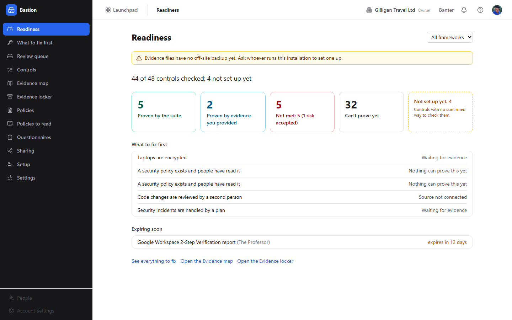

What you see:

- A headline with its denominator, for example "41 of 64 controls checked; 23 not set up yet".
- Four tiles: **Proven by the suite**, **Proven by evidence you provided**, **Not met** (with a risk-accepted sub-count, for example "Not met: 6 (1 risk accepted)"), and **Can't prove yet**.
- A fifth, dashed tile: **Not set up yet**, the controls with no confirmed way to check them.
- The number of days to the audit, when an audit date is set for a framework.
- The top items from What to fix first, one per control (its biggest gap), and an **Expiring soon** list of uploaded evidence about to run out.
- Warning banners when something needs attention: no Compliance project chosen, checks that have not run recently, uploads that were not virus-scanned, evidence storage not working, no off-site backup for evidence files, evidence recording paused after a database restore, updates to other apps that could not be delivered, and uploads stuck waiting for a virus scan.

To use it:

1. Open `/bastion/`.
2. Pick a framework in the **Framework** picker, or leave **All frameworks**.
3. Read the banners first. Each one says what to do and where.
4. Use **See everything to fix**, **Open the Evidence map**, or **Open the Evidence locker** at the bottom to go deeper.

### Setup

**Setup** (`/bastion/setup`, page title **Set up Bastion**) walks an owner or admin through getting started. Each step shows a check mark when it is done. People without the right permission can see where setup stands and are told to ask an admin.

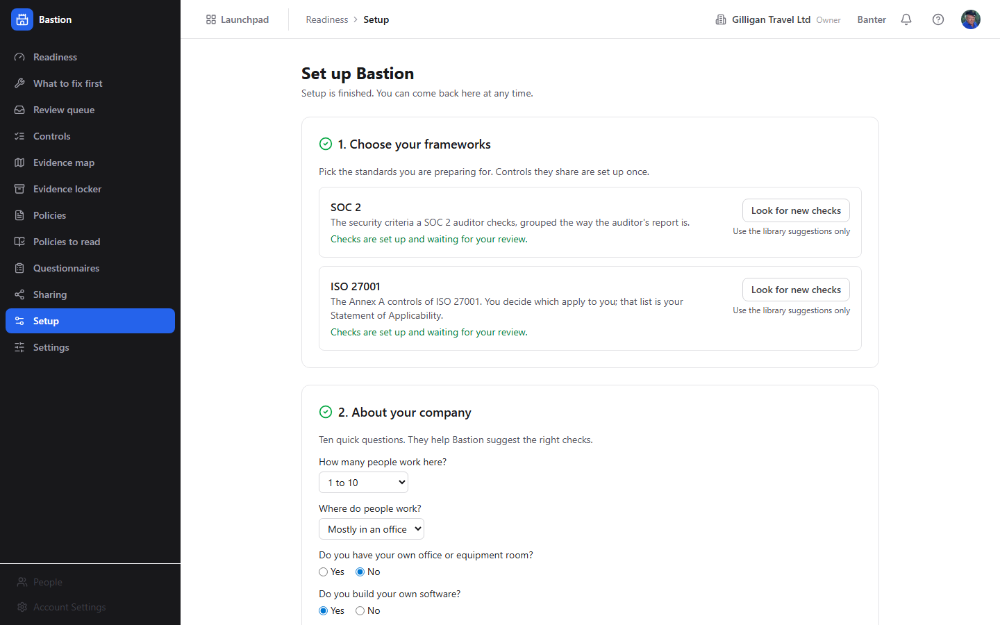

1. **Choose your frameworks**: click **Adopt SOC 2** or **Adopt ISO 27001** (the button names the framework). Then click **Set up checks**. If an AI provider is configured, Bastion's AI tailors the suggested checks to your company and shows progress ("tailoring the checks: 12 of 48 controls"); you can leave the page while it works. **Use the library suggestions only** skips the AI. Once checks are set up, **Look for new checks** runs it again.
2. **About your company**: ten quick questions (company size, where people work, whether you build software, keep code on GitHub, take card payments, and so on). Click **Save answers**.
3. **Compliance project (required)**: when a control needs attention, Bastion files a task in this Bam project so someone owns the fix. Click **Create a "Compliance" project for me**, or **Use an existing project**, pick one, and click **Use this project**.
4. **Review proposed checks**: each proposed check names its control and says in plain words what it checks. Click **Confirm** or **Reject**. Anything you leave counts under Not set up yet. A check that covers a list of systems (your GitHub repositories, or the apps tracked in Blip) shows the list: add or **Remove** members, use **Add repository** or **Add app**, then tick **This is the complete list** before **Confirm** becomes available. A confirmed check keeps working while a change to it waits for review, and it has one waiting change at a time: starting another (or approving a fix that would add to its list) is refused with "This check already has a change waiting for review." Confirm, reject or edit the waiting change first.
5. **Which ISO requirements apply to you?** (ISO 27001 only): for each Annex A requirement click **Applies**, or **Does not apply**, type why, and click **Save reason**. **Everything else applies** marks every undecided requirement as applying. The count "N of M decided" shows progress. Your answers become the Statement of Applicability.

If Bastion's AI thinks some requirements may not apply to you, a box lists them with its reason. Nothing changes until someone decides: click **Does not apply** (with your own reason) or **It applies**.

While viewing Bastion as another person, you cannot confirm or reject checks; only that person can.

### Controls

**Controls** (`/bastion/controls`) lists every control in the chosen framework view.

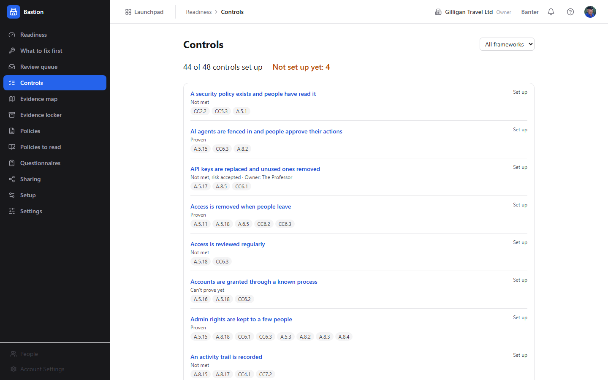

Each row shows the control's title, its current state in words and its owner (once it has been checked), the requirement codes it serves, and whether it is **Set up**, **Not set up yet**, or **Does not apply**. The header shows "N of M controls set up" and the Not set up yet count. Controls that do not apply are listed separately at the bottom.

To open a control, click its title. If no framework has been adopted yet, the page offers **Go to Setup** (or tells you to ask an admin).

### Control detail

Control detail is everything about one control in one place.

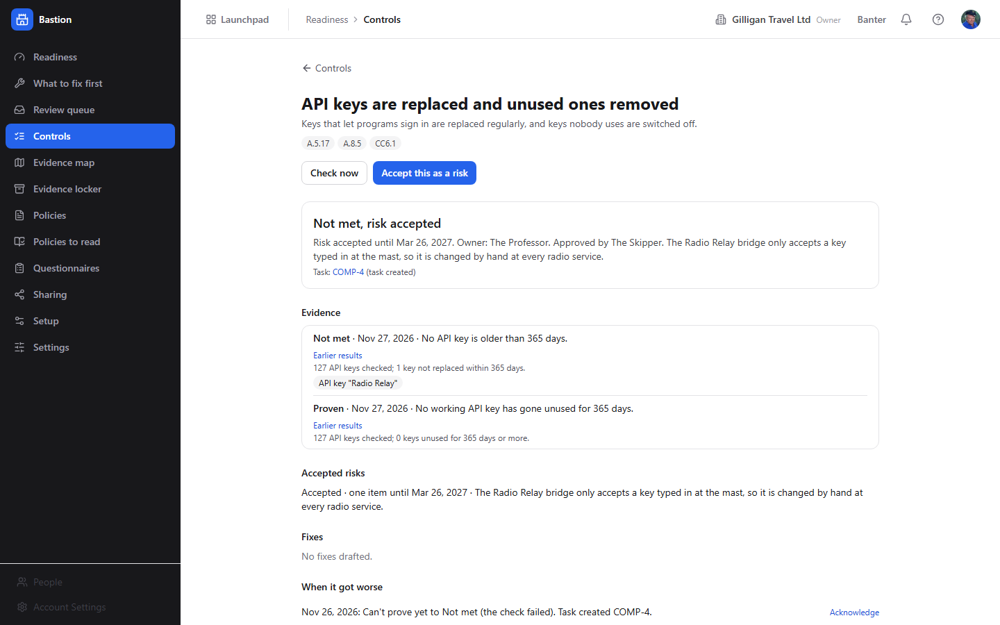

It shows:

- The state in words with its one-sentence reason. An accepted risk reads "Risk accepted until (date). Owner: (name)" with who approved it and why.
- The owner, and the Bam task Bastion filed for this control, with a link.
- **What needs doing**: the open gaps for this control, with a link to **Draft a fix in What to fix first**.
- **Evidence**: each confirmed check once, with its newest result ("Proven", "Not met" or "Can't prove yet", the date, and the check). Click **Earlier results** under a check to see what each earlier nightly or manual check found. Items the result cites appear as named chips when you are allowed to see them; otherwise a line says how many are hidden from you.
- **Accepted risks** on this control, with their status: Accepted, Waiting for approval, Ran out, or Not approved.
- **Fixes** drafted for this control and where each stands.
- **When it got worse**: each time the control's state dropped, why, and what happened to the task. Click **Acknowledge** to record that you have seen it.

To recheck a control without waiting for the night, click **Check now**. The result shows on the page in a minute or two.

### Accepting a risk

Sometimes a failing item is a deliberate choice, for example a long-lived service key you cannot rotate yet. Accepting the risk keeps the control honest: it reads **Not met, risk accepted**, still counts under Not met, and shows its owner and end date everywhere the control appears.

To propose it:

1. On Control detail, click **Accept this as a risk**.
2. Choose **One item (up to a year)** and pick the failing item, or **A whole check (up to 90 days)** and pick the check. A whole-check acceptance covers only the items failing at the time it is approved; a new failure later is not covered.
3. Fill in **Why is this risk acceptable?** and, optionally, **What do you do instead? (optional)**.
4. Set **Accepted until**.
5. Click **Send for approval**.

Someone other than you approves it in the Review queue. In teams with fewer than three people the proposer may approve their own proposal, and it is labelled as a small-team approval. When the date passes, the acceptance runs out, the control drops back to Not met, and the Bam task reopens with a note.

### Evidence map

The **Evidence map** (`/bastion/coverage`) shows where each control's proof comes from.

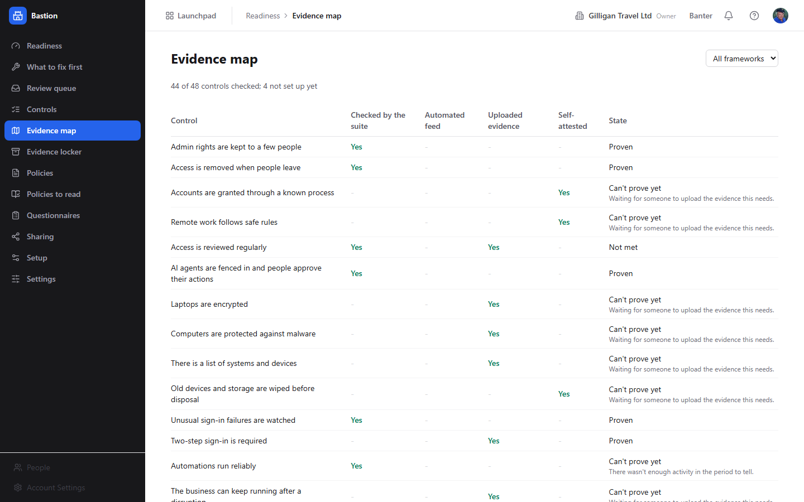

Each row is a control, with a **Yes** in each column that applies: **Checked by the suite**, **Automated feed**, **Uploaded evidence**, **Self-attested**. The last column is the control's state and reason. The footer totals each column and gives the Not set up yet count. Use it to see how much of your readiness rests on statements rather than records.

### What to fix first

**What to fix first** (`/bastion/gaps`) is the ranked list of everything standing between your controls and "Proven".

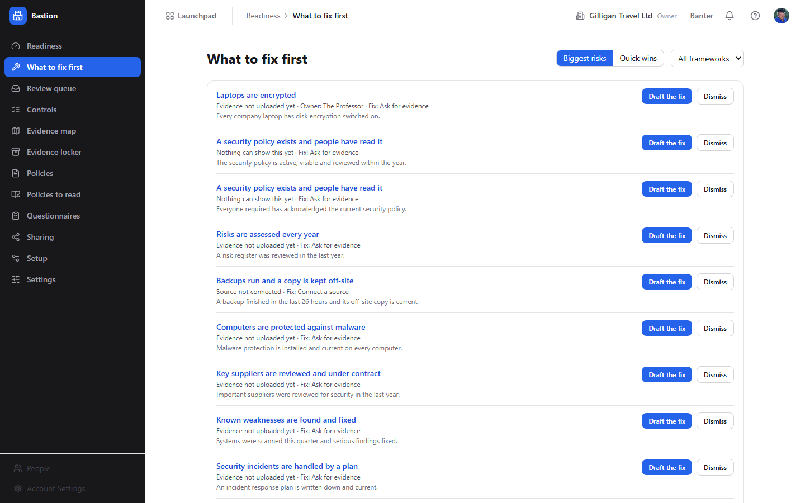

Each row names the control, what is wrong in plain words (for example "Evidence not uploaded yet" or "Something new is not on the list"), its owner, and the kind of fix that would close it.

- **Biggest risks** ranks by how much the control matters, how serious the gap is, and how close the audit is.
- **Quick wins** ranks by risk for the effort, so cheap fixes rise to the top.
- If checks have not run recently, a banner at the top says so. Bastion cannot vouch for a control it has not checked.
- **Accepted risks** at the bottom lists every accepted risk with its owner and end date, so nobody forgets when one runs out. These still count under Not met.

To act on a gap:

1. Click **Draft the fix**. Bastion drafts it and takes you to the Review queue, where a person decides it.
2. Or click **Dismiss**, fill in **Why does this not need fixing?**, and click **Dismiss gap**.

A gap whose fix is already drafted shows **Fix drafted, waiting for a decision**. Controls left unconfirmed for more than 14 days (the grace period in Settings) join the list as not assessed, so nothing silently drops out of view.

### Evidence locker

The **Evidence locker** (`/bastion/evidence`) holds every file and statement people have provided.

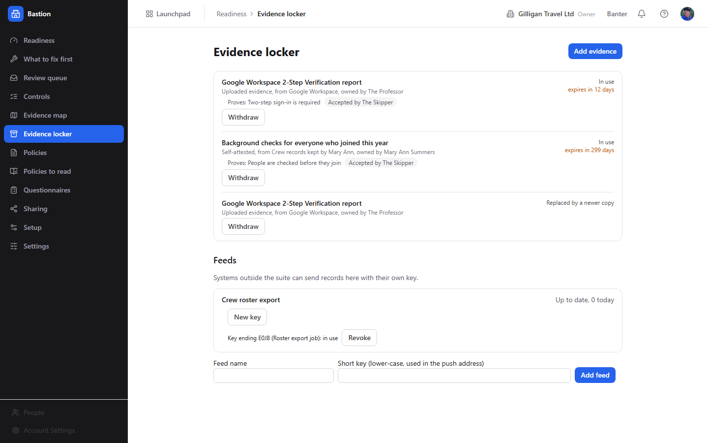

Each item shows what it is, whether it is uploaded evidence or self-attested, which system produced it, its owner, its state (**Waiting for virus scan**, **In use**, **Replaced by a newer copy**, **Withdrawn**, or **Blocked** with the reason), and how long until it expires. Under it, each control it proves shows the review state: **Waiting for review**, **Accepted** (with who accepted it) or **Shows a problem**.

To add evidence:

1. Put the file into Bin first. Bin runs the virus scan.
2. Click **Add evidence**.
3. Choose **A file from Bin** and paste the file's link from Bin, or **A written statement** and write it out.
4. Fill in **What is it**, **Which system produced it**, **Produced on** and **Good until**, and optionally **Covers from (optional)** and **Covers to (optional)**.
5. Under **Who can see it**, choose **Everyone who can see evidence** or **Only people allowed to see restricted evidence**.
6. Tick the confirmation that this is a true and unaltered copy, fit to show an auditor.
7. Click **Save evidence**.

Bastion copies the file into its own storage, so later changes in Bin do not alter what was recorded. A file that is still being scanned waits; one that is infected, failed its scan, or changed in Bin before its scan finished is blocked with a plain reason. Uploads waiting more than a day appear under **Waiting more than a day for a virus scan** with **Check again**.

To review evidence, an owner or admin who is not the uploader clicks **Accept** or **Shows a problem** next to the control it proves. To take evidence out of use, click **Withdraw**, then **Yes, withdraw**; it stops counting as proof and the history keeps a record of the withdrawal.

Note: the Add evidence form does not yet ask which check the item proves. Linking an item to a check is done through Bastion's agent tools today; once linked, the item shows "Proves: (control)" and waits for review.

### Feeds

The **Feeds** section of the Evidence locker is for systems outside the suite that send records to Bastion. Each feed shows whether it is up to date and how many records arrived today.

To add one (owners and admins): fill in **Feed name** and **Short key (lower-case, used in the push address)**, then click **Add feed**. Click **New key** to create the key the outside system uses. The key is shown once: copy it with **Copy**, then click **I have saved it**. When you replace a key, the previous one keeps working for seven more days. To stop a key at once, click its Revoke button and then **Yes, revoke**.

### Review queue

The **Review queue** (`/bastion/review`) is where people decide what Bastion and agents have proposed. Decisions about fixes and accepted risks are made here and nowhere else, by a signed-in person who is not viewing as someone else.

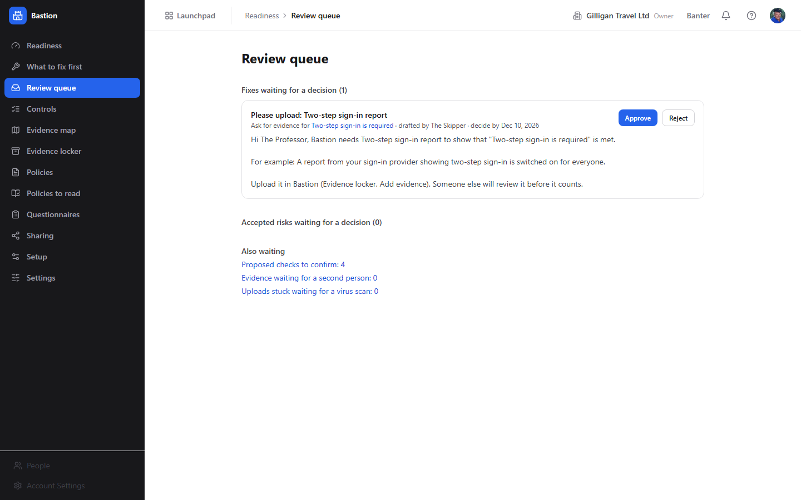

- **Fixes waiting for a decision**: each drafted fix names its control, who drafted it (including when an AI agent drafted it) and the date to decide by. The control's owner, or an owner or admin, clicks **Approve** or **Reject**. Approving an "Ask for evidence" fix files a request on the control's Bam task. Approving an automation fix lets you create it in Bolt, turned off; it can only create a task in the Compliance project.
- **Accepted risks waiting for a decision**: an owner or admin clicks **Approve** or **Reject**. You cannot approve your own proposal unless your team has fewer than three people.
- **Approved fixes to finish**: once you have made the change, optionally paste the link to what you made in Bolt or Beacon, then click **Mark as done**.
- **Also waiting** links to proposed checks to confirm (Setup), evidence waiting for a second person, and uploads stuck waiting for a virus scan (Evidence locker).

### Policies

**Policies** (`/bastion/policies`) tracks the written policies your team must read and acknowledge. The policy itself is a Beacon article; Beacon stays the editor.

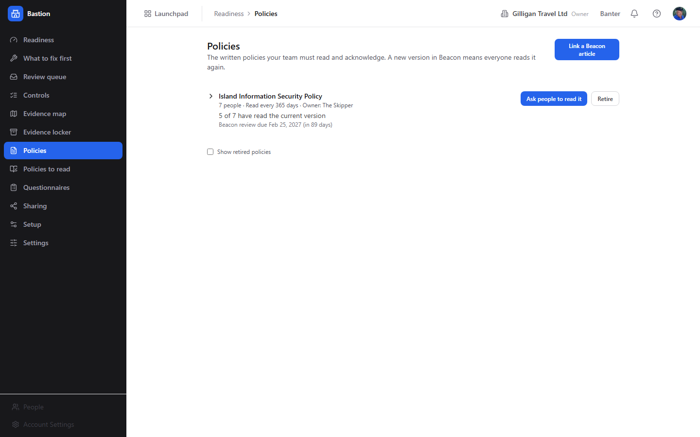

Each policy shows who must read it, how often ("Read every 365 days"), its owner, how many have read the current version, and the Beacon review date. Click a policy to see **Has read the current version** and **Has not read it yet**. People who cannot open the article are marked, with a note to share it with everyone in Beacon. A new version in Beacon means everyone reads it again.

To link a policy (owners and admins):

1. Write the policy in Beacon and share it with everyone in your organization.
2. Click **Link a Beacon article**.
3. Paste the article's link, and set **Everyone reads it again every (days)**.
4. Click **Link this policy**.
5. If the control "A security policy exists and people have read it" is not linked to a policy yet, Bastion links its two checks (kept current; read by everyone) to this policy and puts them in the **Review queue**. Confirm them there. From the next check on, the control shows how many people have read the current version: **Proven** when everyone has, **Not met** while anyone has not.

**Ask people to read it** sends a reminder to everyone who has not read the current version. **Retire** stops tracking a policy; tick **Show retired policies** to see retired ones.

If the Beacon article behind a policy is removed, withdrawn (retired or archived) or past its review date, nobody is asked to read it and acknowledgements pause. The policy shows a red note saying which, and what to do: restore the article in Beacon, or click **Link a Beacon article** to add its replacement and then **Retire** this one. A policy cannot be pointed at a different article. Only people who can open the article in Beacon, and the people who manage the policy, see which of these happened.

### Policies to read

**Policies to read** (`/bastion/attest`) is every person's own list.

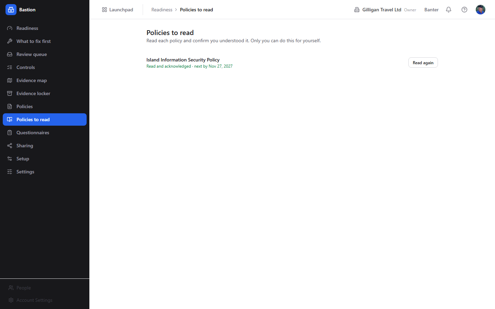

1. Click **Read it** next to a policy.
2. Read the text. It is exactly the saved version in Beacon.
3. Click **I have read and understood this**.

Bastion records which version you read. Only you can do this for yourself: it cannot be done while someone is viewing Bastion as you, and agents cannot do it. **Read again** opens a policy you have already acknowledged.

A policy with nothing to read right now has no button, and says why: "This policy's article was removed. Nothing to do.", "This policy was withdrawn. Nothing to do.", or "Paused while its owner reviews it. Nothing to do for now." If you cannot open the article in Beacon yourself and do not own the policy, it only says "Nothing to do for now."

### Questionnaires

**Questionnaires** (`/bastion/questionnaires`) answers customers' security questionnaires from what Bastion can prove. Bastion drafts each answer, says how sure it is, and never claims what it cannot prove. A person approves before anything goes out.

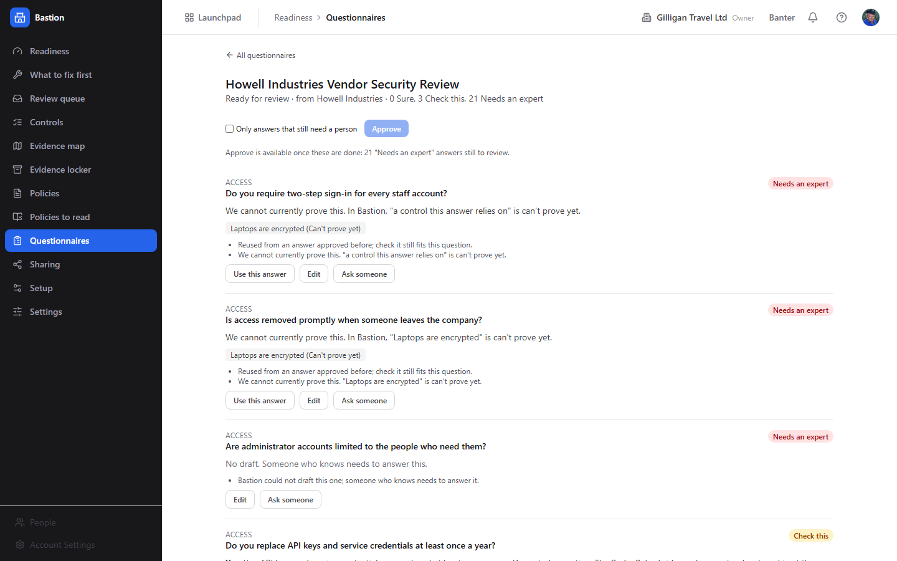

Each drafted answer carries a confidence word:

- **Sure** - every control it cites is proven.
- **Check this** - probably right, but a person should look. An answer that relies on an accepted risk is never better than this, and the answer names the accepted risk.
- **Needs an expert** - Bastion could not support an answer, or a control it relies on is not met, can't be proven, or is not set up. The answer then says "We cannot currently prove this." and names each such control with the status its page shows, for example: We cannot currently prove this. In Bastion, the control "Laptops are encrypted" shows "Can't prove yet".

To answer a questionnaire:

1. Click **Add a questionnaire**. Give it a **Name** (for example "Howell Industries Vendor Security Review") and, optionally, **Who sent it (optional)**.
2. Choose **Paste the rows** and paste the questions with their header row, or **A file in Bin (Excel or CSV)** and paste the file's link. Click **Add it**.
3. In **Check the columns**, confirm which column holds the questions (**Questions are in**) and where answers go (**Write answers into**, **Yes or No goes into**). If you change them, click **Use these columns**.
4. Click **Draft the answers**. Progress shows "N of M done" with a time estimate.
5. Review each answer: **Use this answer**, or **Edit**, change it, and **Save this answer**. **Undo review** reopens one. Tick **Only answers that still need a person** to focus.
6. When every "Needs an expert" answer has been reviewed, click **Approve** (owners and admins, not while viewing as someone else). If something still blocks approval, the page lists it.
7. Click **Download answers (Excel)** or **Download answers (CSV)**. The answers are written into the customer's own layout.

**Draft again the answers nobody reviewed** redrafts only rows nobody has touched. If a question reads like instructions to a computer, Bastion marks it "Needs an expert" and says so.

### Answer library

The **Answer library** on the Questionnaires page keeps every answer you approved. Bastion reuses them in later questionnaires, but only for the same question (or one worded almost the same way), and a reused answer cites the controls it was approved against. A question no approved answer was written for is never given one about another subject. When a control an answer relies on changes, the answer is marked to check again; an owner or admin clicks **It still holds** or **Retire**. Use **Search approved answers** to find one.

### Sharing: auditor rooms

**Sharing** (`/bastion/sharing`) is where owners and admins share their readiness with an auditor. An auditor room is a private link that works without a BigBlueBam account, for a set number of days.

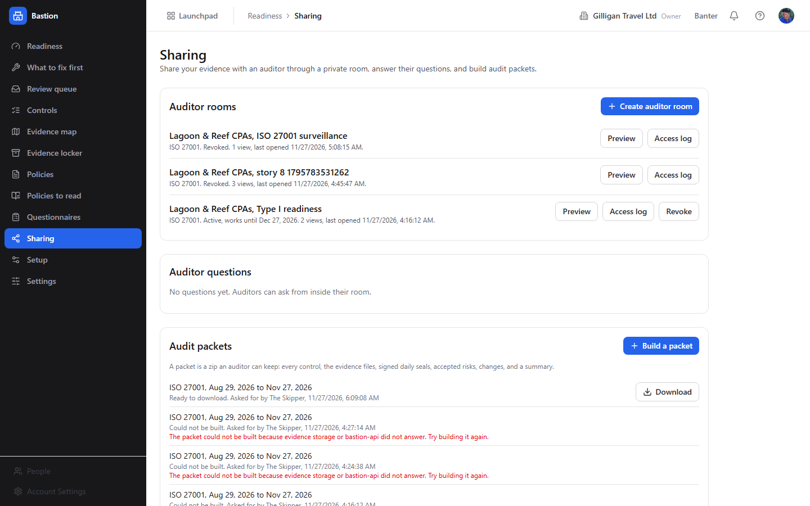

To create a room:

1. In **Auditor rooms**, click **Create auditor room**. (You need a framework adopted in Setup first.)
2. Fill in **Who is this for?** (for example "Lagoon & Reef CPAs, Type I readiness"), pick the **Framework**, and set the period with **From** and **To**.
3. Set **How long the link works (days)**. It starts at 30 and can never be more than the limit in Settings, or more than 180.
4. Optionally fill in **Passcode (optional, 6 digits)**. Send the passcode to the auditor separately from the link.
5. Under **Restricted evidence to include**, tick any restricted items the auditor should see. Restricted items stay hidden from the auditor unless you tick them here. (This list appears only for people allowed to see restricted evidence, and only when there is some.)
6. Click **Create room**.
7. The link is shown once, under "Copy this link now. It is shown only once." Click **Copy link**, send the link to the auditor in a private message, then click **I have copied it**.

The link looks like `/bastion/room#` followed by a long code. The code sits after the `#`, a part of the address browsers never send to servers or write into logs. Anyone with the link can open the room until it expires or you revoke it.

The list shows the rooms that are still open (Active or Locked). Tick **Show closed rooms** to also see revoked and expired ones.

Each room row shows its label, framework, whether it is Active, Expired, Revoked or Locked, the date it works until, how many times it was viewed, when it was last opened, and how many questions are open. The actions are:

- **Preview** shows the room exactly as the auditor sees it ("This is exactly what the auditor sees."): the controls, the restricted items you included, and, for ISO 27001, the Statement of Applicability.
- **Access log** lists every view, with the columns When, What, Visitor and Device. The auditor's network address is kept only as a one-way fingerprint.
- **Unlock** appears when a room locked itself after 5 wrong passcodes, so the auditor can try again. You are notified when a room locks.

### Revoking an auditor room

To end an auditor's access, click **Revoke** on the room's row. Bastion asks "Revoke this room? The link stops working at once and cannot be turned back on." Click **Revoke room** to confirm, or **Keep it** to change your mind. A revoked room cannot be reopened; create a new room if the auditor needs access again.

Creating, revoking and unlocking a room are disabled while you are viewing Bastion as another person.

### Sharing: auditor questions

Auditors can ask questions from the room. They appear under **Auditor questions** on the Sharing page, with who asked, which room, the control it is about (if any), and whether it is Open, Answered or Closed. Click **Answer**, write your reply, and click **Send answer**. Click **Close** when the question is dealt with.

### Sharing: audit packets

An audit packet is a zip file for your auditor to keep. To build one:

1. In **Audit packets**, click **Build a packet**.
2. Choose the **Framework** and the period with **From** and **To** (at most 400 days).
3. Tick **Include restricted evidence** if the auditor should get restricted items. Only people allowed to see restricted evidence get this option.
4. Click **Build packet**.
5. Watch the progress line in the list: "Collecting controls", "Checking recorded names", "Writing evidence 120 of 412", "Rendering summary", "Zipping", "Uploading".
6. Click **Download** when it is ready.

A packet that reads **Could not be built** shows the reason under it. Fix the cause and build a new packet, then click **Dismiss** on the failed one to clear it from the list. Dismissing only hides it: the packet stays in Bastion's records, and the dismissal is written to the audit log. A packet that was built can never be dismissed.

A packet contains a manifest listing every file with its fingerprint, every signed daily seal with every public key needed to check them, any restore notices, `controls.csv` and `controls.jsonl`, the evidence files and selected uploaded files, `attestations.csv`, `exceptions.csv`, `drift.csv`, `statement_of_applicability.csv` (ISO 27001), and `summary.pdf`. For each item that records people's names, the manifest says whether those names still match what was recorded (intact), were changed, were removed on request (redacted), or were recorded under an older key.

An ISO 27001 packet cannot be built until every Annex A requirement has an applicability decision in Setup. For ISO 27001 the section also offers "Download the Statement of Applicability for ISO 27001" on its own.

Treat a downloaded packet as confidential: it contains your evidence.

### The auditor room

The auditor room (`/bastion/room`) is the page your auditor opens from the link. It needs no BigBlueBam account; the top bar simply reads "Auditor room".

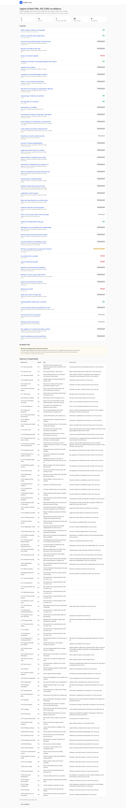

If you set a passcode, the auditor first sees "Enter the 6-digit passcode" and clicks **Open the room**. A wrong passcode shows "That passcode is not right." with how many tries are left before the room locks. Tries sent at the same moment all count, so if several are already being checked the room answers "Too many passcode tries are being checked at once. Wait a moment and try again." Only wrong passcodes count toward the lock: a try that was interrupted (for example, the page failed to load) is given back within a minute.

The auditor then sees:

- The room's label as the heading, "Shared by (your organization) until (date)", the framework and the period.
- A reminder that Bastion shows the evidence your organization collected, is not an auditor, and does not certify anything.
- Plain notices wherever the history is incomplete, for example "History lost by restore" or "Unexplained gap" with the range of entries. Nothing is hidden.
- Five counts: Met, Not met, Not met, risk accepted, Can't prove yet, and Not assessed (controls you have not set up).
- **Controls**: every control in the room with its state and requirement codes. Clicking a control opens its **Requirements**, its **Checks in the period**, its **Uploaded evidence**, and any accepted risks. Each check or file opens on its own, with **Download**. Downloading a file gives the file itself; downloading a check gives the same summary the room shows (counts only, no names) plus the record's fingerprint, which matches the one in an audit packet. A file that can no longer be found reads "Evidence file missing". **Back to all controls** returns to the list.
- **Restricted evidence included**, when you ticked restricted items.
- **Accepted risks**, each with its reason, what is done in the meantime, its owner and the date it is accepted until.
- **Statement of Applicability** (ISO 27001), with whether each requirement applies, why, and how it is met.
- **Technical details: signed daily seals**, the seal history with the public keys, so the auditor can check the history independently and keep their own copy.

To ask a question, the auditor clicks **Ask a question**, fills in **Your name**, optionally **About which control (optional)**, and **Your question**, then clicks **Send question**. A room accepts at most 20 questions an hour.

A revoked, expired or locked link shows "This link is no longer available."

### Settings

**Settings** (`/bastion/settings`) holds how Bastion checks your controls, files fixes and shares evidence. Everyone who can open it sees the values; owners and admins can change them.

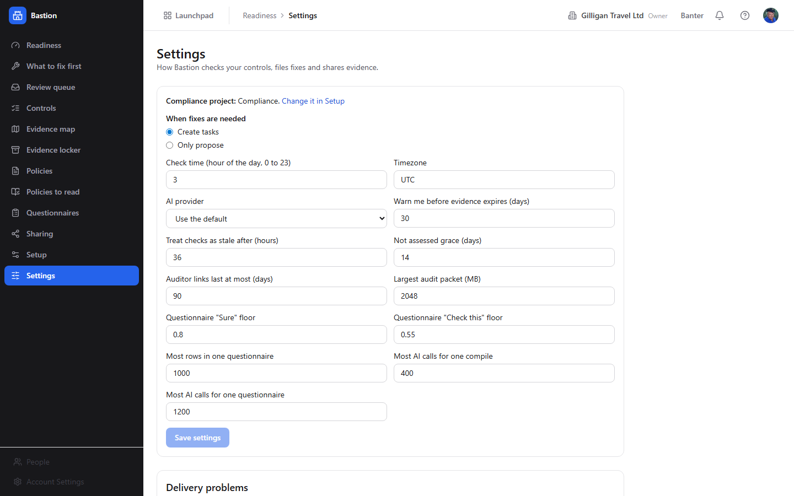

- Compliance project: the Bam project where Bastion files tasks, shown here for reference. Use **Change it in Setup** to pick another.
- **When fixes are needed**: **Create tasks** files a Bam task as soon as a control gets worse; **Only propose** files none, and a person drafts a fix from the gap instead.
- **Check time (hour of the day, 0 to 23)**: the hour of the nightly check (3 by default).
- **Timezone**: the timezone for the check time and for expiry dates (UTC by default).
- **AI provider**: which AI provider Bastion uses to tailor checks, draft answers and word fixes. **Use the default** follows your organization's default provider.
- **Warn me before evidence expires (days)**: how early uploaded evidence shows as expiring (30 by default).
- **Treat checks as stale after (hours)**: after this long without a check, Bastion stops vouching for a control (36 by default).
- **Not assessed grace (days)**: how long an unconfirmed control waits before joining What to fix first (14 by default).
- **Auditor links last at most (days)**: the longest an auditor room may last (90 by default, never more than 180).
- **Largest audit packet (MB)**: the size limit for a packet.
- **Questionnaire "Sure" floor** and **Questionnaire "Check this" floor**: how sure Bastion's AI must be (from 0 to 1) before an answer can read "Sure" or "Check this". Defaults are 0.8 and 0.55.
- **Most rows in one questionnaire**, **Most AI calls for one compile**, and **Most AI calls for one questionnaire**: limits that keep one job from running away.

Click **Save settings** to apply changes. Only the fields you changed are sent.

### Delivery problems

The **Delivery problems** section of Settings (owners and admins) lists updates Bastion could not deliver to other apps after many tries, for example events to Bolt or task updates to Bam, with when it happened and how many times it was tried. Click **Try again** to send one again. **Technical details** shows the last error. When the list is empty it reads "Everything was delivered." Readiness shows a banner while any are waiting.

### Evidence integrity

The **Evidence integrity** section of Settings is for the people who look after the evidence history.

**Gaps in the evidence history.** If the database is restored from a backup, part of Bastion's history may be lost. Bastion notices, shows when it found the gap and which entries were lost, and pauses recording new evidence until an owner looks at it. Owners see one of two buttons:

- **Acknowledge restore**, when the database was restored from a backup. Confirming with **Yes, continue** records the gap as "History lost by restore" and resumes recording.
- **Continue without an explanation**, when no restore explains the gap. Confirming with **Yes, continue** resumes recording, and auditors will always see "Unexplained gap" for those entries.

Either way the gap stays visible to auditors; acknowledging only changes its label, never hides it. These buttons are disabled while you are viewing Bastion as another person. When nothing is waiting, the section reads "No gaps in the evidence history are waiting for you."

**Off-site evidence backup.** Whether a separate off-site backup for evidence files is set up, when the last database backup ran, and how the last copy of evidence files went: "Copied", "Partly copied, continues after the next backup", "The last copy failed", "Not set up", or "Copying now".

**Technical details: key fingerprints** lists the fingerprints of the keys that sign the daily seals (current and retired) and of the key that protects recorded names. An auditor can compare them with the ones in a packet.

### Behind the scenes

A few things happen without anyone clicking:

- **The nightly check.** At the check time in Settings, Bastion checks every confirmed control, records each result in its history, and re-ranks What to fix first. If a control gets worse, Bastion files or reopens its Bam task in the Compliance project. A check that fails for a technical reason never counts as a compliance failure; Bastion tries again the next night.
- **Daily seals.** Once a day Bastion signs the latest point of its history.
- **Off-site evidence backup.** Every night, after the database backup, Bastion copies new evidence files to a separate off-site backup, if one is configured. A failed copy never fails the database backup. Large files get more time to copy (at least a minute, more for big files). If one file still cannot be copied, Bastion skips it, copies the rest, shows "Partly copied, continues after the next backup", and tries that file again after the next backup. Readiness warns when no off-site backup is configured.
- **Clean-up.** A daily sweep removes leftover copies of files whose save never finished.
- **Reminders.** People who have not read a policy are reminded once each period, and uploaded evidence is flagged before it expires.

#### For administrators

If evidence files are lost from storage (for example after rebuilding a host), copy them back from the off-site backup by running `node dist/cli.js restore-objects --from-backup` inside the bastion-api container. It prints its progress as it goes. When the database is reachable it leaves out any file that was redacted (and removes one already copied back); if the database is not back yet it copies everything, prints "NOT FINISHED", and you run the same command again once the database is restored. The off-site backup location is set by whoever runs the installation, separately from the main storage and ideally with a different provider. The keys that sign seals and protect recorded names must be kept safe alongside the database backup; without them a rebuilt installation cannot keep signing under the same key.

### Working with AI agents

Agents can do most of the routine work through Bastion's `bastion_*` MCP tools, under the same permissions and audit as a person, once an operator allows `bastion.*` tools in the agent's policy. Common agent tasks:

- Read status and gaps: `bastion_coverage_summary`, `bastion_list_controls`, `bastion_control_status`, `bastion_coverage_gaps`, `bastion_list_drift`.
- Read evidence: `bastion_evidence_for`, `bastion_get_evidence`, `bastion_verify_evidence`, `bastion_list_manual_evidence`.
- Set up and check: `bastion_compile_framework`, `bastion_propose_assertion`, `bastion_run_evaluation`.
- Draft work for a person to decide: `bastion_propose_fix`, `bastion_propose_exception`.
- Questionnaires: `bastion_create_questionnaire`, `bastion_questionnaire_autofill`, `bastion_draft_answer`, `bastion_search_answer_library`.
- Sharing (owners' and admins' permissions): `bastion_list_auditor_rooms`, `bastion_auditor_room_view`, `bastion_list_auditor_requests`, `bastion_respond_auditor_request`, `bastion_create_export`, `bastion_list_exports`.
- Settings and operations: `bastion_get_settings`, `bastion_update_settings`, `bastion_list_delivery_problems`, `bastion_retry_delivery`, `bastion_audit_log`.

Some acts are deliberately reserved for a signed-in person, never an agent or an API key: confirming or rejecting checks, deciding fixes and accepted risks, accepting uploaded evidence, approving a questionnaire, acknowledging a policy, creating, revoking or unlocking an auditor room, and resolving a gap in the evidence history. When an agent acts for a person, it sees no more than that person could: the reads that name records (evidence, the Evidence locker, drafted fixes and accepted risks) require the agent to say whom it is answering, and show only the items both of them may open. Anything an agent drafts lands in the Review queue labelled as drafted by an AI agent.

Changes that alter what Bastion reports as compliant take two steps when an agent makes them: archiving a framework, marking a requirement not applicable, dismissing a gap, unlinking evidence from a check, and retiring a policy. The first call only explains what will happen and returns a confirmation token; nothing changes until the agent calls again with that token within five minutes. Marking a requirement applicable and other policy edits happen in one step.

## User Stories

### Story: Set up Bastion for a first SOC 2 review

**Who:** Skipper, the owner of Gilligan Travel Ltd.
**Goal:** Get Bastion checking SOC 2 controls every night.
**Before you start:** You are an owner or admin of the organization.

**Steps**

1. Open `/bastion/` and click **Setup** in the sidebar.
2. Under **Choose your frameworks**, click **Adopt SOC 2**, then **Set up checks**. Wait for the progress line to finish (you can leave the page).
3. Under **About your company**, answer the ten questions and click **Save answers**.
4. Under **Compliance project (required)**, click **Create a "Compliance" project for me**.
5. Under **Review proposed checks**, read each check. Click **Confirm** for the ones that fit and **Reject** for the rest. For the GitHub check, make sure both repositories are listed, tick **This is the complete list**, then click **Confirm**.
6. Open **Readiness**.

**Result:** Readiness shows "N of M controls checked" with a Not set up yet count for anything you left. The first nightly check fills in the numbers, or use **Check now** on any control.

**Related:** `bastion_compile_framework` and `bastion_get_setup_status` let an agent run and watch the same setup.

### Story: Decide which ISO 27001 requirements apply

**Who:** Skipper.
**Goal:** Finish the Statement of Applicability for ISO 27001.
**Before you start:** ISO 27001 is adopted in Setup.

**Steps**

1. Open **Setup** and scroll to **Which ISO requirements apply to you?**
2. For the physical-security requirements, click **Does not apply**, type "We operate from a shared island hut with no server room", and click **Save reason**.
3. Click **Everything else applies** for the rest.
4. Check that the count reads "93 of 93 decided".

**Result:** Every Annex A requirement has a decision. The excluded controls move to Does not apply in the ISO view, and an ISO audit packet can now be built.

### Story: Read where you stand

**Who:** Anyone in the organization.
**Goal:** Understand today's readiness in one look.
**Before you start:** Setup is done and at least one nightly check has run.

**Steps**

1. Open **Readiness**.
2. Read the headline, for example "41 of 64 controls checked; 23 not set up yet".
3. Compare **Proven by the suite** with **Proven by evidence you provided** to see how much rests on records versus uploads.
4. Read the **Not met** tile, including how many are risk accepted.
5. Switch the **Framework** picker to ISO 27001 to see that framework's view.

**Result:** You know how much is proven, how much is not met, how much cannot be proven yet, and how much setup is left, without any number hiding another.

### Story: Upload evidence and have it accepted

**Who:** The Professor uploads; Skipper reviews.
**Goal:** Prove two-step sign-in with the Google Workspace report.
**Before you start:** The report is uploaded to Bin, and the two-step sign-in check asks for uploaded evidence.

**Steps**

1. The Professor opens **Evidence locker** and clicks **Add evidence**.
2. He chooses **A file from Bin** and pastes the report's link from Bin.
3. He fills in **What is it** ("Google Workspace 2-Step Verification report"), **Which system produced it** ("Google Workspace"), **Produced on**, and **Good until**.
4. He ticks the confirmation and clicks **Save evidence**. The item shows **Waiting for virus scan**, then **In use**.
5. Once the item is linked to the two-step sign-in check, Skipper opens **Evidence locker** and clicks **Accept** next to "Proves: (the two-step sign-in control)".

**Result:** The control counts under **Proven by evidence you provided** after the next check, and Readiness lists the report under **Expiring soon** as its end date nears.

### Story: Fix the top gap

**Who:** Skipper.
**Goal:** Start closing the riskiest gap.
**Before you start:** At least one nightly check has run.

**Steps**

1. Open **What to fix first**. Leave **Biggest risks** selected.
2. Read the top row, for example laptop encryption with "Evidence not uploaded yet".
3. Click **Draft the fix**. Bastion takes you to the **Review queue**.
4. Read the drafted fix and click **Approve**.

**Result:** The fix is approved; for an evidence request, the control's Bam task in the Compliance project gets the request. The gap shows the fix as drafted until the next check proves the control.

**Related:** `bastion_coverage_gaps` and `bastion_propose_fix` let an agent draft the same fix; a person still approves it here. See the next story.

### Story: Have an agent draft the fix for the top gap

**Who:** An AI agent drafts; Skipper decides.
**Goal:** Let an agent find the riskiest gap and draft its fix, while a person keeps the decision.
**Before you start:** At least one nightly check has run. An operator has allowed `bastion.*` tools in the agent's policy, and the agent may draft fixes (`bastion.fix.draft`).

**Steps**

1. Ask the agent to draft the fix for Bastion's top gap. It calls `bastion_coverage_gaps`, which returns What to fix first ranked by biggest risk, and picks the first open gap, for example laptop encryption with "Evidence not uploaded yet".
2. The agent calls `bastion_propose_fix` with that gap and, if it wants, a short note. Bastion chooses the kind of fix from the gap, and the agent has no tool that can approve it.
3. Open **Review queue** in Bastion. The fix is under **Fixes waiting for a decision**, marked "drafted by" the agent's name followed by "(an AI agent)".
4. Read the drafted fix and click **Approve**. If it is not right, click **Reject** instead, and the gap goes back to open.

**Result:** The agent did the finding and drafting; the decision is yours and is recorded under your name. An approved fix takes effect exactly as in the previous story. A rejected one leaves the gap open for someone to draft again.

**Related:** "Working with AI agents" above lists which acts only a signed-in person can do.

### Story: Accept the risk on the Radio Relay key

**Who:** The Professor proposes; Skipper approves.
**Goal:** Record that the long-lived "Radio Relay" service key is a known, accepted risk for a while.
**Before you start:** The API key control is Not met because of the Radio Relay key.

**Steps**

1. The Professor opens **Controls**, clicks the API key control, and clicks **Accept this as a risk**.
2. He chooses **One item (up to a year)** and picks the Radio Relay key.
3. He types why the risk is acceptable and what is done instead, and sets **Accepted until**.
4. He clicks **Send for approval**.
5. Skipper opens **Review queue**, reads the proposal under **Accepted risks waiting for a decision**, and clicks **Approve**.

**Result:** The control reads **Not met, risk accepted** with the owner and end date, still counts under Not met, and appears under Accepted risks on What to fix first. When the date passes, the control drops back to Not met and its task reopens.

### Story: Get everyone to read the security policy

**Who:** Mary Ann links the policy and nudges; Gilligan reads it.
**Goal:** Have every member acknowledge the "Island Information Security Policy".
**Before you start:** The policy is written in Beacon and shared with everyone.

**Steps**

1. Mary Ann opens **Policies**, clicks **Link a Beacon article**, pastes the article's link, and clicks **Link this policy**.
2. She clicks the policy to see who **Has not read it yet**, then clicks **Ask people to read it**.
3. Gilligan opens **Policies to read**, clicks **Read it**, reads the policy, and clicks **I have read and understood this**.

**Result:** Gilligan moves to **Has read the current version**. When everyone in the audience has read it, the policy control can be proven after the next check.

### Story: Answer the Howell questionnaire

**Who:** Skipper.
**Goal:** Return the "Howell Industries Vendor Security Review" with honest answers.
**Before you start:** The questionnaire file is in Bin.

**Steps**

1. Open **Questionnaires** and click **Add a questionnaire**.
2. Name it "Howell Industries Vendor Security Review", choose **A file in Bin (Excel or CSV)**, paste the file's link, and click **Add it**.
3. In **Check the columns**, confirm **Questions are in** points at the question column, then click **Draft the answers**.
4. When drafting finishes, tick **Only answers that still need a person**.
5. For each "Needs an expert" answer, click **Edit**, write what you can honestly say, and click **Save this answer**. Note that the Radio Relay row reads "Check this" and names the accepted risk.
6. Click **Approve**.
7. Click **Download answers (Excel)**.

**Result:** You have the customer's own spreadsheet with answers filled in, and the approved answers are in the **Answer library** for next time.

**Related:** `bastion_questionnaire_autofill` lets an agent start the drafting; only a person can approve.

### Story: Share readiness with your auditor

**Who:** Skipper.
**Goal:** Give Lagoon & Reef CPAs a private view of the SOC 2 controls.
**Before you start:** You are an owner or admin.

**Steps**

1. Open **Sharing** and click **Create auditor room**.
2. Type "Lagoon & Reef CPAs, Type I readiness" in **Who is this for?**, pick SOC 2 under **Framework**, and set **From** and **To**.
3. Leave **How long the link works (days)** at 30, type six digits in **Passcode (optional, 6 digits)**, and tick any restricted items the auditor needs under **Restricted evidence to include**.
4. Click **Create room**, then **Copy link**. Send the link and the passcode to the auditor in separate private messages, then click **I have copied it**.
5. Click **Preview** on the room's row to see exactly what the auditor sees.
6. Later, click **Access log** to see when the auditor opened the room.

**Result:** The auditor can read your controls and evidence for 30 days. To end access early, click **Revoke**, then **Revoke room**.

### Story: Build an audit packet

**Who:** Skipper.
**Goal:** Give the auditor a copy of the ISO 27001 evidence to keep.
**Before you start:** Every Annex A requirement has an applicability decision.

**Steps**

1. Open **Sharing** and, under **Audit packets**, click **Build a packet**.
2. Choose ISO 27001 under **Framework**, set **From** and **To**, and click **Build packet**.
3. Watch the progress line in the list until **Download** appears.
4. Click **Download** and send the zip to the auditor through a channel you trust.

**Result:** The auditor has the controls, evidence, signed seals with public keys, and the Statement of Applicability in one file they can keep and check independently.

### Story: Review a room as the auditor

**Who:** An auditor at Lagoon & Reef CPAs.
**Goal:** Review Gilligan Travel's controls and ask a follow-up question.
**Before you start:** You have the room link and, if one was set, the passcode.

**Steps**

1. Open the link. If asked to "Enter the 6-digit passcode", type it and click **Open the room**.
2. Read the counts and the **Controls** list. Click a control to see its **Checks in the period** and **Uploaded evidence**, open a file, and click **Download**. Click **Back to all controls** to return.
3. Open **Technical details: signed daily seals** and save a copy of the seals and public keys, and read any notices about gaps in the history.
4. Click **Ask a question**, fill in **Your name**, pick the control under **About which control (optional)**, type **Your question**, and click **Send question**.

**Result:** "Your question was sent. The team will answer it in Bastion." The question appears under **Auditor questions** on the Sharing page, where Skipper can answer it with **Send answer**. Keep your own copies of anything you download.

### Story: Acknowledge a database restore

**Who:** Skipper, as an owner.
**Goal:** Resume evidence recording after the database was restored from a backup.
**Before you start:** Readiness shows the banner about evidence recording being paused.

**Steps**

1. Open **Settings** and go to **Evidence integrity**.
2. Read the notice: when the gap was found and which entries were lost.
3. Click **Acknowledge restore**, read the confirmation, and click **Yes, continue**.

**Result:** Recording resumes. The lost range stays visible to everyone, including auditors, as "History lost by restore". If the notice instead says no restore explains the gap, the button is **Continue without an explanation**, and the range stays labelled "Unexplained gap".

## Related

- **Bam** receives the remediation tasks Bastion files in your Compliance project.
- **Beacon** holds the policies people read; Bastion records who acknowledged which version.
- **Bin** is where you put evidence files and questionnaires before attaching them.
- **Blip** supplies the list of tracked apps some checks cover.
- **Bolt** receives Bastion's events, and approved automation fixes are created there, turned off.
- **Banter** can carry the weekly readiness summary through a Bolt rule.
- **Bursar** supplies the vendor-award facts one supplier control checks.
- See `guide.md` in `docs/apps/bastion/` for a plain-language guide to what each status means.
