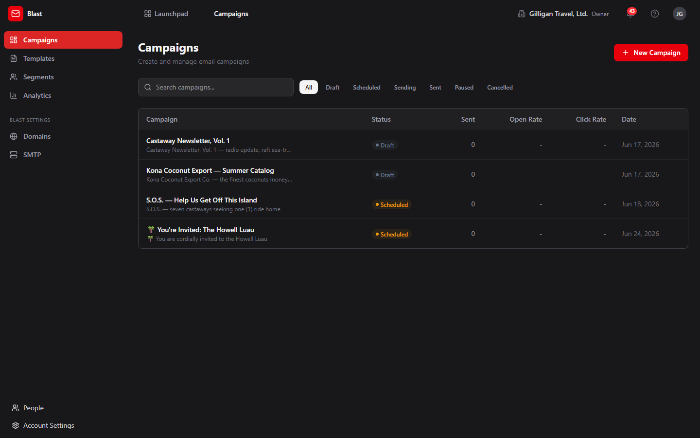
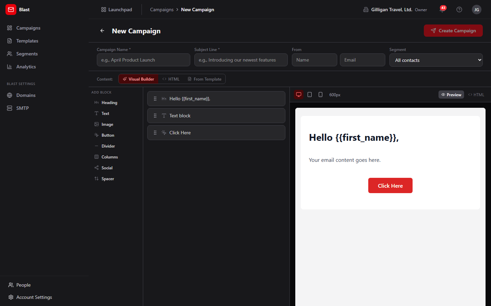
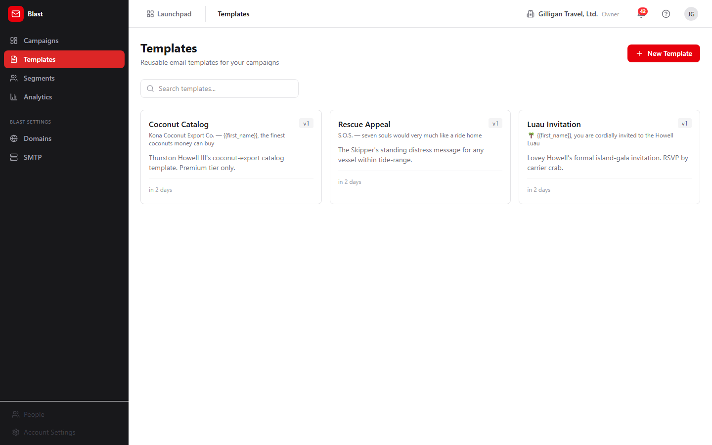

<!-- AUTODOCS:GENERATED by scripts/docs/compose.mjs from the _narrative.md / _marketing_hook.md beside it. Edit that source, not this file, then run pnpm docs:compose. -->

# Blast (Email Campaigns)

Turn your Bond CRM contacts into email campaigns, with a visual builder, saved segments, and full open and click analytics.

- Design emails in a drag-and-drop visual builder, raw HTML, or reusable versioned templates
- Target sends with saved segments that filter your Bond CRM contacts
- Track opens, clicks, bounces, and unsubscribes per campaign and across the org
- Built-in CAN-SPAM gate, automatic unsubscribe suppression, and SPF/DKIM/DMARC domain verification
- Reach your team without scheduling: the persistent Bureau presence dock lets you see who is around and start a voice or video huddle from anywhere in Blast

## See It in Action

---

Part of the [BigBlueBam](/) productivity suite.
