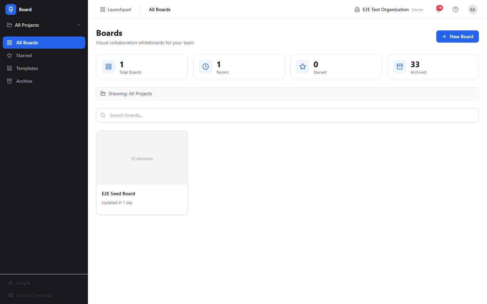
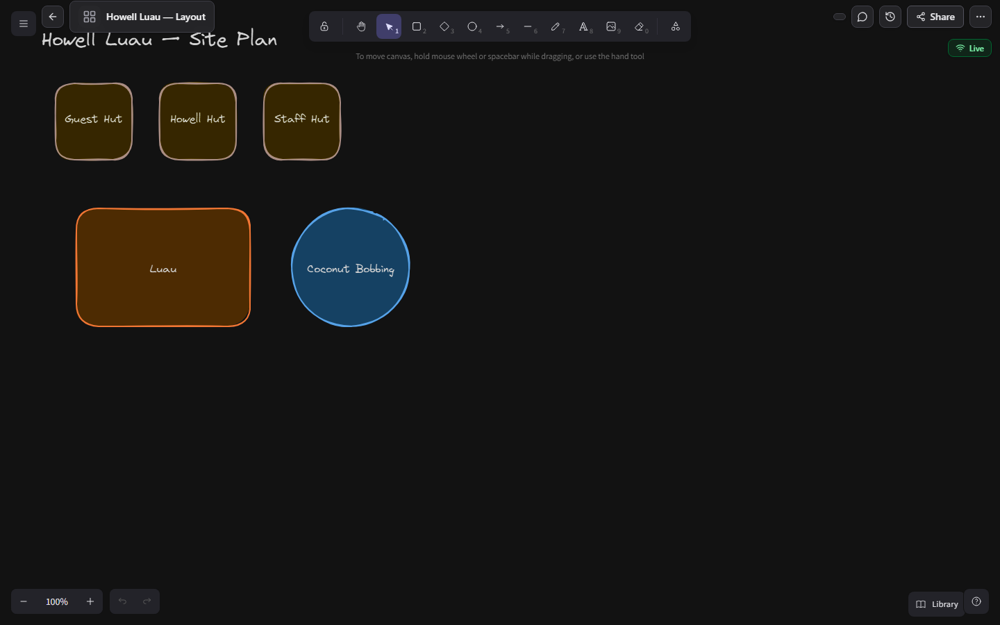
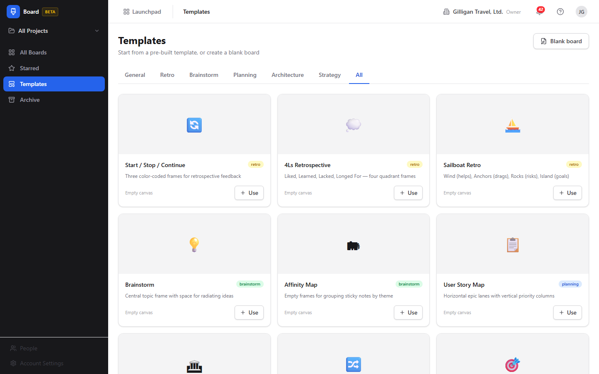

<!-- AUTODOCS:GENERATED by scripts/docs/compose.mjs from the _narrative.md / _marketing_hook.md beside it. Edit that source, not this file, then run pnpm docs:compose. -->

# Board (Visual Collaboration)

An infinite canvas for real-time visual collaboration and brainstorming.

- Sticky notes, shapes, connectors, frames, and freehand drawing on an infinite Excalidraw canvas
- Real-time collaboration with live cursors, plus voice huddles from the platform presence bar
- Workshop templates and version snapshots for retros, brainstorms, planning, and architecture diagrams
- Promote brainstorm stickies straight into tracked Bam tasks, with AI agents that build and read the canvas

## See It in Action

---

Part of the [BigBlueBam](/) productivity suite.
